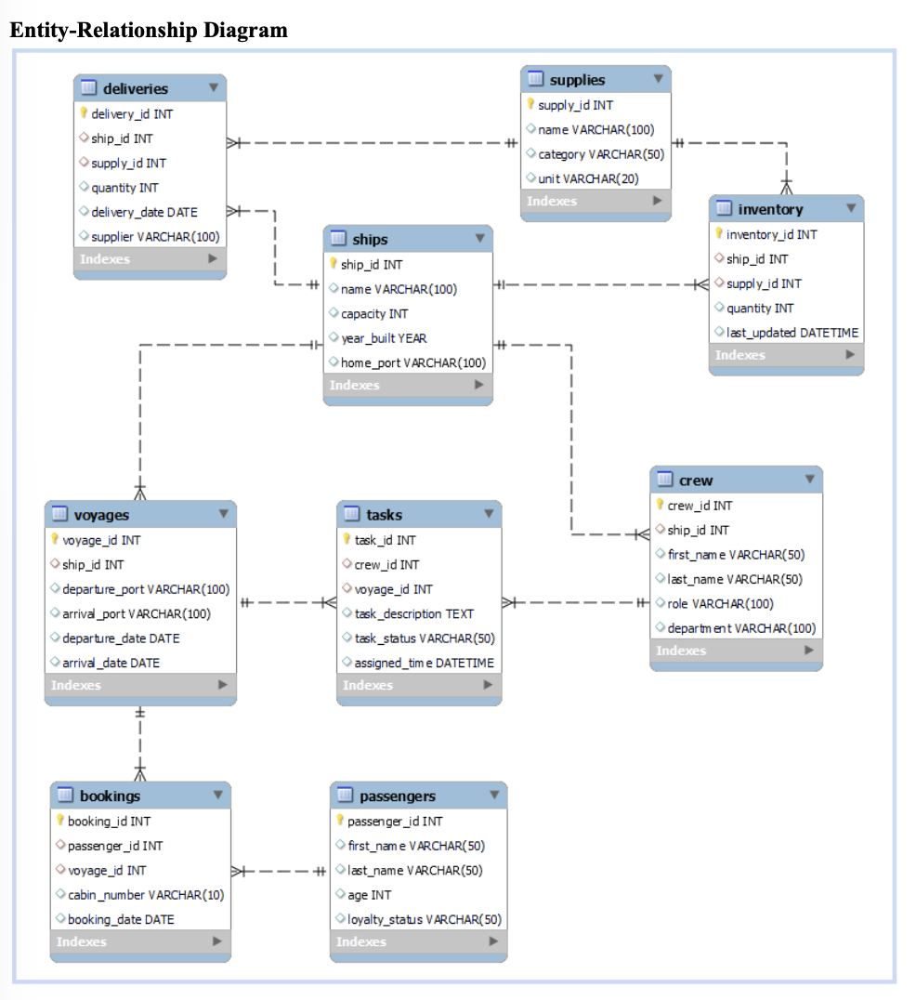

# 🛳️ Carnival Cruise Line: Ship Operations Database

**Team project · Florida International University · Spring 2026**

**Tools:** MySQL · MySQL Workbench · Relational database design · ER modeling

## Overview
Large cruise ships run like small cities, but much of their day-to-day tracking (crew task assignments, passenger manifests, supply inventory, and deliveries) has traditionally relied on paper logs and manual tallies. That makes records slow to update, easy to lose, and hard to access in an emergency.

Our team designed a MySQL relational database that centralizes Carnival's ship operations data. We then wrote 10 business queries showing how managers could use it to make faster, better-informed decisions.

## My Role
I led the **final presentation**, turning the database design, ER diagram, and query results into a stakeholder-facing deck that explained the business problem, the data model, and the value of each query. Built as part of a four-person team.

## Data Model
A **9-table relational schema** with **8 foreign key relationships** that enforce referential integrity:

| Area | Tables |
|---|---|
| Fleet & routes | `ships`, `voyages` |
| Staff | `crew`, `tasks` |
| Guests | `passengers`, `bookings` |
| Supply chain | `supplies`, `inventory`, `deliveries` |



## Business Questions Answered
Each query was written for a specific decision-maker:

| # | Question | Who uses it | SQL techniques |
|---|---|---|---|
| 1 | Which crew members have no tasks assigned? | Staff Manager | `LEFT JOIN` + `IS NULL` |
| 2 | What is the most recent delivery for each ship? | Supply Manager | `GROUP BY` + `MAX()` |
| 3 | Is any crew member overloaded with multiple tasks? | Staff Manager | `HAVING COUNT() > 1` |
| 4 | Which passengers are in the loyalty program, and at what tier? | Loyalty Manager | `WHERE IN` + `ORDER BY` |
| 5 | Which ship has the lowest total supplies and needs restocking? | Supply Manager | `SUM()` + `ORDER BY` + `LIMIT` |
| 6 | Which passengers will be in Jamaica on June 16? | Guest Services | Multi-table `JOIN` + date filter |
| 7 | Which voyages have the most pending or in-progress tasks? | HR Manager | Conditional `SUM()` aggregation |
| 8 | Which crew member is navigating the Bahamas route (storm alert)? | Director of Fleet Operations | `JOIN` across tasks and voyages |
| 9 | What is the oldest task that is still pending? | Chief Maritime Officer | `MIN()` on timestamps |
| 10 | Which passengers are not in the loyalty program? | Marketing Manager | Filtering for targeting |

**Example: Voyages with the most open tasks (Q7)**
```sql
SELECT voyage_id,
       SUM(task_status = 'in progress') AS in_progress_count,
       SUM(task_status = 'pending')     AS pending_count,
       COUNT(task_id)                   AS total_count
FROM tasks
WHERE task_status IN ('in progress', 'pending')
GROUP BY voyage_id
ORDER BY total_count DESC;
```

## Business Value
- **Efficiency:** replaces paper-based task, booking, and inventory tracking with a single source of truth.
- **Safety:** crew and passenger records are instantly accessible during emergencies and evacuations.
- **Decision-making:** managers can spot understaffed shifts, low inventory, and overdue tasks in seconds.
- **Sustainability:** removes the paper records generated on every voyage.

## Files
- [📐 Entity-relationship diagram (erd.png)](erd.png)
- [📄 Final presentation deck (PDF)](presentationCCL.pdf)
